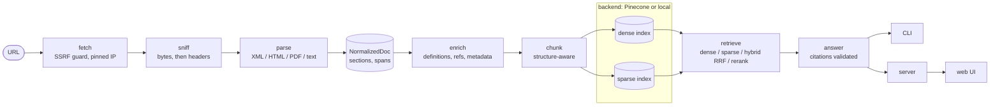

# legislation-summary (working title)

[](https://github.com/ylove/legislation-summary/actions/workflows/ci.yml)

> Paste a link to one bill. Get a plain-language answer to "what does this say, and how does it affect me?", with every claim cited to the section it came from.

The product name is not final and this repository will be renamed. The name lives in one file, [`src/core/brand.ts`](src/core/brand.ts).

**What it does**

- **Reads the structure, not just the words.** It ingests one URL or local file (XML, HTML, PDF with a text layer, or plain text), finds sections, definitions and cross-references, and tells struck-out text from inserted text.
- **Retrieves, then answers with citations.** Hybrid retrieval (dense, sparse, rerank) picks the excerpts. The model may use only those, and every `[S:<section>]` citation is checked against what was retrieved.
- **Runs on your machine.** An `npx` CLI and a local web UI. A built-in local backend needs no account. You bring your own keys.

> **Status: release candidate.** Everything in the [status table](#status) is on `main` and tested. The Pinecone backend is built and unit-tested against a fake, but has not yet been run against a live index (that needs a key).

## Demo

<!-- DEMO_GIF -->

## Quick start

Requires Node.js 22.13 or newer (CI runs 22 and 24).

```sh
npx legislation-summary init                       # save provider keys (file mode 0600)
npx legislation-summary <url>                      # ingest, then serve and open the document
npx legislation-summary ingest <url> --name hb62   # ingest only, with a label
npx legislation-summary ingest ./bill.pdf          # a local file works too (CLI only)
npx legislation-summary ask hb62 "When does this take effect?"
npx legislation-summary ask hb62 --chip what-changes
npx legislation-summary list
npx legislation-summary remove hb62
npx legislation-summary serve --port 4317          # local web UI; --public allows chips only
npx legislation-summary eval --backend local       # retrieval eval on the downloaded fixtures
```

`<doc>` is a label or a doc-id prefix. Flags are defined in [`src/cli/program.ts`](src/cli/program.ts).

- `--chip <id>` is one of `summary`, `what-changes`, `who-affected`, `penalties`, `effective-date`, `money`, `definitions`, `sponsors`. Each chip has its own retrieval strategy in [`src/core/chips.ts`](src/core/chips.ts). `sponsors` reads metadata only and makes no LLM call.
- `--backend pinecone|local` overrides backend selection on `ingest`, `ask`, `list`, `remove` and `eval`.
- A local path or `file://` URL is read directly, with the same 50 MB cap and format sniffing as a download. Only the file name is recorded, never the directory. The web server accepts only `http(s)` URLs, so a web request can never name a local file.
- If an HTML page only wraps the real bill, ingest lists the candidate PDF/XML links and stops. It never follows them on its own.
- Re-ingesting the same bytes is a no-op: the `docId` is the SHA-256 of the raw bytes. The default cap is 5 documents, evicting the least recently used.

### Keys and providers

`init` writes `~/.legislation-summary/config.json`. Environment variables win over the file. `init --non-interactive` copies the provider settings and keys currently in your environment into that file (mode 0600) without prompting, which is meant for scripted setups; it prints no keys. Without a configured provider, `ask` and `ingest` fail with a message listing the options. List, remove and the `sponsors` chip work without any key.

| Provider     | Key                 | Notes                                                                                    |
| ------------ | ------------------- | ---------------------------------------------------------------------------------------- |
| `anthropic`  | `ANTHROPIC_API_KEY` | Defaults `claude-sonnet-5-5` (answers) and `claude-haiku-5-5` (metadata extraction)      |
| `openai`     | `OPENAI_API_KEY`    | `OPENAI_BASE_URL` points it at any OpenAI-compatible endpoint (OpenRouter, Ollama, Groq) |
| `google`     | `GOOGLE_API_KEY`    | Official Google GenAI SDK                                                                |
| `claude-cli` | none                | Opt-in, local development only: `LEGSUM_LLM_PROVIDER=claude-cli`. Uses your own `claude` |
| `mock`       | none                | Deterministic, used by tests and CI                                                      |

Keyless HTTP endpoints are accepted only on `localhost`, `127.0.0.1` or `[::1]`. The `claude-cli` provider never reads or forwards credentials and is never chosen automatically ([decision 0003](docs/decisions/0003-claude-cli-provider.md), [provider details](docs/llm-providers.md)). Override models with `LEGSUM_ANSWER_MODEL` and `LEGSUM_EXTRACT_MODEL`.

### Backends

- **local** (default): no Docker, no account. Dense vectors from quantized `bge-small-en-v1.5` (384 dimensions) via transformers.js, sparse search with an explicit BM25 (`k1=1.2`, `b=0.75`), and a quantized MiniLM cross-encoder as reranker. About 59 MB of models download once, from revisions pinned in [`models.lock.json`](models.lock.json). Code: [`src/core/index/local/`](src/core/index/local/).
- **pinecone**: selected when `PINECONE_API_KEY` resolves; integrated-inference dense and sparse indexes plus hosted rerank ([decision 0001](docs/decisions/0001-pinecone-plus-local-backend.md)). Each document is a namespace. A document counts as indexed only after a completion marker is written once every batch has landed in both indexes, so a half-finished ingest is never mistaken for a finished one. Code: [`src/core/index/pinecone/`](src/core/index/pinecone/). Its live contract suite runs nightly when a key is configured; it has not run yet.

Embeddings never go through the LLM provider.

### Status

| Piece                                                                   | State on `main`                                               |
| ----------------------------------------------------------------------- | ------------------------------------------------------------- |
| Fetch, parse, enrich, chunk, local backend, retrieval, answer, chips    | Implemented and tested                                        |
| CLI `init`, `ingest`, `ask`, `list`, `remove`, `serve`, `eval`, `<url>` | Implemented and tested; e2e and package smoke run in CI       |
| Server: REST, SSE, public mode, web UI                                  | Implemented and tested                                        |
| Eval harness and golden sets                                            | Implemented; results in [`eval/results.md`](eval/results.md)  |
| Pinecone adapter                                                        | Implemented and tested against a fake; live run pending a key |

## Architecture



Everything below `NormalizedDoc` is format-agnostic. The CLI, server and eval all call the same functions in [`src/core/pipeline/`](src/core/pipeline/).

- **Fetch** ([`src/core/fetch/`](src/core/fetch/)). `http`/`https` only, ports 80, 443, 8080 and 8443, 30 s timeout, 50 MB cap, at most 5 redirects. Every hop is re-validated and connected by pinned IP. Format is sniffed from the bytes first (`%PDF`, XML prolog or root, `<html`), then Content-Type, then extension. Raw bytes are cached by SHA-256.
- **Parse** ([`src/core/parse/`](src/core/parse/)). XML (`saxes`), HTML (`cheerio`), PDF (`pdfjs-dist`) and plain text all produce a `NormalizedDoc`: a section tree whose text is a list of `unchanged | inserted | deleted` spans. PDF also recovers printed line numbers and strips running headers. A scanned PDF stops with a clear OCR-not-supported error.
- **Enrich** ([`src/core/enrich/`](src/core/enrich/)). Definitions (each becomes its own chunk), internal cross-references, external references listed as "referenced, not loaded", and bill metadata. Metadata comes from structured fields when present. Otherwise an LLM extracts it under a strict zod schema where every field is nullable and guards reject values not found in the text.
- **Chunk** ([`src/core/chunk/`](src/core/chunk/)). Never crosses a section boundary. Targets 300 to 450 tokens, hard maximum 480, with 50 tokens of overlap. Each chunk is embedded with its breadcrumb prefix (`Sec. 4 > (b) Eligibility: ...`); the raw text is stored separately for display. Chunk ids are deterministic, so re-ingest is an idempotent upsert.
- **Index** ([`src/core/index/`](src/core/index/)). One dense and one sparse index per document, with a `RetrievalBackend` port ([`src/core/model/`](src/core/model/), frozen by [decision 0005](docs/decisions/0005-frozen-contracts.md)) in front of Pinecone and the local store.
- **Retrieve** ([`src/core/retrieve/`](src/core/retrieve/)). Four modes: `dense`, `sparse`, `hybrid` (40 candidates from each index, merged by Reciprocal Rank Fusion with k=60) and `hybrid_rerank` (the default: fuse, rerank at most 64 candidates, keep 8). Then up to 5 definitions of terms used in the hits are injected.
- **Answer** ([`src/core/answer/`](src/core/answer/)). Excerpts go to the model as escaped `<excerpt>` data. The system prompt demands citations, a verbatim decline sentence when the excerpts do not answer, and about a 7th-grade reading level. Citations are validated after generation (see [Security](#security-notes)).
- **Chips** ([`src/core/chips.ts`](src/core/chips.ts)). Eight one-click questions, each with an explicit strategy: sparse-heavy (`effective-date`, `penalties`), filtered by chunk type (`money`, `definitions`), reranked (`who-affected`), outline map-reduce (`summary`), exact amendment spans (`what-changes`), and metadata only (`sponsors`).
- **Surfaces.** CLI in [`src/cli/`](src/cli/), server in [`src/server/`](src/server/), React UI in [`src/web/`](src/web/).

## Why retrieval instead of stuffing the context window

<!-- CONTEXT_STUFFING -->

Long bills fit in some context windows, but fitting is not the same as working. Sending the whole bill on every question costs its full token count each time, and a model asked about one clause has to find it among thousands of lines, with no way to show which words it relied on. Retrieval sends a few hundred tokens of the right sections, which keeps cost flat as bills grow and makes each citation point at text the model was actually shown. It also lets the pipeline do things a flat prompt cannot: exclude struck text before the model sees it, add the definitions a clause depends on, and choose a different strategy per question. The measured cost and accuracy comparison on the large federal fixture is still to come.

## Amendment markup

Bills that amend existing law show the change with typography: struck-through text is being repealed and underlined text is being added. In a PDF's text layer, or in flattened HTML, repealed words are character-for-character ordinary words. A naive RAG pipeline embeds them as current law, retrieves them, and answers "the bill requires X" when the bill deletes X. For a legislation tool that is the failure that matters most.

How it is handled:

- **Detect.** Every parser maps markup to a span status.
  - **HTML** ([`html.ts`](src/core/parse/html.ts)): `<s>`, `<strike>` and `<del>` mean deleted; `<u>` and `<ins>` mean inserted; inline `text-decoration` and `.class` or `tag.class` CSS rules are honored. A strike wins over an underline. Tag-only rules are ignored on purpose, so ordinary link underlines are not read as insertions.
  - **PDF** ([`pdf-geometry.ts`](src/core/parse/pdf-geometry.ts)): there is no markup, only thin horizontal rules drawn near glyphs. Marks are classified in ems from the baseline, per glyph, requiring 70% coverage, with negative controls for table rules, highlights, link underlines and white cover-up rectangles. Struck and underlined together is read as deleted, because calling repealed text current is the worse error. [Decision 0006](docs/decisions/0006-pdf-amendment-geometry.md) records the measurements and every threshold.
- **Separate.** Deleted spans never go into normal chunk text. They become their own chunks with `amendmentStatus = deleted`. Inserted text stays in normal chunks and is flagged.
- **Exclude by default.** Retrieval filters to `unchanged` and `inserted` unless the question is about changes (a pattern check on the question) or the chip explicitly asks for deleted text. After the backend returns, retrieve filters again, so a backend that ignores the filter cannot leak struck text. The answer prompt separately tells the model to say "the bill removes ..." for deleted excerpts.
- **Keep struck words out of structure.** On PDFs, sections are detected on the text with struck characters removed, so a struck heading or a struck relettered marker never becomes a `heading`, breadcrumb or embedding text. A local test checks this on the real HB 62 file.
- **`what-changes` shows before and after.** It is built from the section tree, not from retrieval ([`chip-changes.ts`](src/core/chip-changes.ts)). For each changed section the model sees two excerpts of only the sentences that contain a change: the BEFORE sentence with struck words as `[-...-]`, and the AFTER sentence with new words as `[+...+]`. Struck words appear only in the BEFORE excerpt. The chip shows at most 25 changed sections and counts the rest.

The real Ohio HB 62 fixture (135th General Assembly, as introduced) parses to 26 struck runs and 28 inserted runs, matching a count taken by hand on the rendered pages. Fixtures are downloaded locally, never committed (see [Development](#development)).

## Retrieval quality

Retrieval quality is measured, not asserted. Five golden sets are frozen in [`src/eval/golden/`](src/eval/golden/), 21 to 28 questions each, for Ohio SB 113, SB 203 and HB 62, federal S. 202 and federal H.R. 5009 (the FY2025 NDAA, about 450k tokens). Each question names its expected `section_id`s and has a kind: exact citation lookup, paraphrase, definition-dependent, "what does it remove" (struck text), or unanswerable (three per set, which should be declined). The sets were frozen at commit `7639f18` before the first run and have not been edited since.

Local backend (`bge-small-en-v1.5` embeddings, BM25, `ms-marco-MiniLM-L-6-v2` reranker), recall@5 / MRR, from [`eval/results.md`](eval/results.md):

| Fixture                  | dense           | sparse      | hybrid (RRF) | hybrid (weighted) | **hybrid_rerank** (default) |
| ------------------------ | --------------- | ----------- | ------------ | ----------------- | --------------------------- |
| Ohio HB 62               | 0.95 / 0.79     | 0.88 / 0.68 | 1.00 / 0.85  | 0.95 / 0.76       | 0.95 / **0.87**             |
| Ohio SB 113              | 1.00 / 0.81     | 0.83 / 0.76 | 0.89 / 0.84  | 0.94 / 0.84       | **1.00 / 0.90**             |
| Ohio SB 203              | 0.71 / 0.63     | 0.76 / 0.63 | 0.86 / 0.66  | 0.86 / 0.66       | **0.95 / 0.74**             |
| Federal S. 202           | **0.90** / 0.70 | 0.68 / 0.62 | 0.80 / 0.71  | 0.85 / 0.71       | 0.85 / **0.83**             |
| Federal H.R. 5009 (NDAA) | **0.96** / 0.89 | 0.82 / 0.68 | 0.92 / 0.81  | **0.96 / 0.92**   | 0.88 / 0.86                 |

What this shows, plainly:

- **The default mode ranks best on four of five bills** (highest MRR), and finds more of the right sections than dense alone on SB 203. It ties dense on two bills and **loses to dense on two**: S. 202 by one question (17 of 20 in the top 5, against 18) and the NDAA by two (22 of 25, against 24).
- **Where each mode wins** (share of questions with a relevant section in the top 5, all bills pooled): `hybrid_rerank` leads on exact lookups (0.97 vs 0.90 for dense) and definitions (0.84 vs 0.79); dense leads on paraphrases (0.95 vs 0.93) and on "what does it remove" (1.00 vs 0.91).
- **Dense misses, hybrid finds it.** SB 203, _"Does trading one gun for another count as a 'transfer'?"_ Dense retrieval ranks the definitions division that answers it 8th, behind seven other passages of the same section (2923.27), and BM25 alone does not surface it at all. Because both lists feed one candidate pool, the cross-encoder gets to read the question against that division directly and ranks it first.
- **Where the reranker hurts.** On the NDAA, _"Does the military now have to buy American-made forks, spoons, and dishes?"_ Dense ranks Sec. 842, "Domestic production of stainless steel flatware and dinnerware", first; the small cross-encoder (22M parameters, trained on web search) does not connect _forks and spoons_ to _flatware_ and pushes it out of the top 10. The NDAA's very long heading paths (Division > Title > Subtitle > Sec.) also crowd its 512-token window. A stronger reranker, such as the `bge-reranker-v2-m3` that Pinecone hosts, is the obvious next step; weighted fusion without rerank is the best local mode on the NDAA.
- **One fix came from this eval.** The reranker originally scored chunk text without its heading path, while the embedder saw both. Giving it the same context (#97) raised MRR on four of five bills (average 0.797 to 0.841) and cost S. 202 two borderline questions. The change was made after looking at results, so both runs are kept in the repository history.

Answer quality (citation validity, decline rate, deleted-text leakage, reading grade) is in [`eval/results-answers.md`](eval/results-answers.md). Pinecone rows are pending until the nightly job runs with a key. Each table records the commit, models and golden-set freeze it came from. Per-question ranks for every mode are written to `eval/runs/*.json`, and `eval compare` lists the questions where two modes disagree ([details](docs/eval.md)).

Caveats: 21 to 28 questions per bill means one question moves recall@5 by about 0.05. Ranks are chunk ranks (the first chunk whose section, or an ancestor or descendant, is expected). Two questions name their section numbers outright (hb62-03, sb203-08), and some paraphrases reuse rare words from the text, which makes them easier for BM25.

## Security notes

- **SSRF guard** ([`src/core/fetch/`](src/core/fetch/)).
  - Resolved addresses are checked against private, loopback, link-local, CGNAT, multicast, documentation, unique-local and other special-use IPv4 and IPv6 ranges. Cloud metadata `169.254.169.254` falls inside link-local.
  - IPv6 forms that embed an IPv4 address (IPv4-mapped, NAT64, 6to4, Teredo) are unwrapped and checked. Scoped and unparsable addresses fail closed.
  - The connection goes to the validated address itself, pinned, so a DNS answer cannot change between check and connect (rebinding).
  - Each redirect is re-resolved and re-validated, up to 5. Credentials in URLs are refused, as are ports outside 80, 443, 8080 and 8443.
  - Bodies are capped at 50 MB, with a 30 s timeout.
- **Prompt injection** ([`src/core/answer/`](src/core/answer/)). Bill text is hostile data. Excerpt text and the user's question are XML-escaped, so neither can close an excerpt tag or forge a new source. The system prompt states that excerpts are data, not instructions. Citations are validated: every `[S:id]` must be a section that was in the prompt; invalid markers are stripped and reported, and an answer with no valid citation (other than the exact decline sentence) carries a warning. Synthetic injection samples live in [`tests/synth/injection.ts`](tests/synth/injection.ts). Citation validation is held to 90% line coverage along with the fetch layer.
- **Local server** (`serve`). Binds to `127.0.0.1` by default. Unless public mode is on, requests whose `Host` or `Origin` is not the loopback address it serves are refused, which blocks DNS-rebinding attacks from web pages you visit. Cancelling a question or an ingest in the UI aborts the work, including the download.
- **Public mode** (`serve --public`). Chips only (no free-form questions), per-IP limits of 20 questions and 3 ingests per hour, a 200-page ingest cap, a global document cap that refuses new documents instead of evicting someone else's, and a Cloudflare Turnstile stub.
- **Bring your own keys.** `init` writes the config file with mode 0600, and a config file that is group- or world-readable is ignored with a warning, and `init --force` replaces it. Keys are read from the environment first, then that file, then a masked prompt on a TTY. Keys go only to their own provider, are not inferred from another provider's variables, and are never logged or put in error messages; SDK diagnostic logging is off. `.env` and fixtures are ignored by git, and CI runs Gitleaks over the full history.
- **`claude-cli` sandboxing.** Each call runs in a fresh temporary directory holding only the system prompt file, with built-in tools disabled (`--tools ""`), all MCP servers disabled, one turn, slash commands, hooks and settings sources off, no session persistence, and no permission-bypass flag. The child sees only basic process variables plus `CLAUDE_*` and `ANTHROPIC_*`, so other providers' keys and app settings are excluded. It refuses to run for real in CI.

## Development

```sh
npm ci
npm run check            # lint, typecheck, format check, tests with coverage
npm run build            # dist/cli.js, dist/server.js, dist/web/
node dist/cli.js --help
```

- `npm run fixtures:fetch` downloads the six public documents in [`fixtures/manifest.json`](fixtures/manifest.json) into the gitignored `fixtures/downloads/`, checking SHA-256 and size. Fixtures are never committed; local fixture tests skip when the files are absent, and CI uses generated samples from [`tests/synth/`](tests/synth/). See [`fixtures/README.md`](fixtures/README.md).
- `npm run models:fetch` pre-downloads the local models. `npm run test:models` runs the offline suite against the real models (not part of `check`, which uses fakes).
- `npm run test:live` runs key-gated provider contract tests and spends tokens. It never runs the Claude CLI.
- `npm run smoke:package` and `npm run test:e2e` run the packed-tarball smoke and the Playwright suite locally. Set `PLAYWRIGHT_BROWSERS_PATH="$PWD/.cache/ms-playwright"` and run `npx playwright install chromium` once.
- Unit tests block outbound HTTP, so adapters take injected fetchers and spawners.

CI ([`ci.yml`](.github/workflows/ci.yml)) runs these jobs:

| Job                 | What it checks                                                                                                      |
| ------------------- | ------------------------------------------------------------------------------------------------------------------- |
| `lint-type`         | ESLint, both typechecks, Prettier, `npm audit` for production deps                                                  |
| `test`              | Coverage-gated tests on Node 22 and 24 (Ubuntu) and Node 22 (macOS)                                                 |
| `build`             | Production build and a `--help` smoke check                                                                         |
| `no-fixtures-guard` | Fails if real legislation files are committed                                                                       |
| `secrets`           | Gitleaks over full history                                                                                          |
| `dependency-review` | Blocks high-severity and GPL-family dependencies on pull requests                                                   |
| `eval-smoke`        | Synthetic golden set end to end; fails if `hybrid_rerank` < `dense`                                                 |
| `package-smoke`     | Packs the tarball (allowlisted contents), installs it in a clean dir, runs `init`, `ingest`, `ask`, `list`, `serve` |
| `e2e`               | Chromium against the packed build: chip streaming, citation drawer, SSRF block, remove                              |

CodeQL, a nightly Pinecone contract check (only with a key) and a local-model offline suite run in their own workflows.

Conventions are in [`AGENTS.md`](AGENTS.md): the frozen contracts in `src/core/model/`, the product name only in `brand.ts`, tests beside code, and no network in unit tests. The [spec](docs/spec.md) is the source of truth and its Amendments override the rest. Design choices and their reasons are recorded in [`docs/decisions/`](docs/decisions/).

## Roadmap

- **v1.5:** resolve a bill from number plus jurisdiction to a URL, then run the same pipeline.
- **v2:** natural-language discovery search across bills.
- **v2:** allowlisted official secondary sources only (fiscal notes, nonpartisan analyses). News articles are never used.
- Fetch statutes that a bill references, which are listed as "referenced, not loaded" today.
- Akoma Ntoso export of the normalized document.
- Not planned for the RC: OCR for scanned PDFs, hosted deployment.

## Disclaimer

Not legal advice. Answers are generated only from the text of the document.

## License

[MIT](LICENSE)
