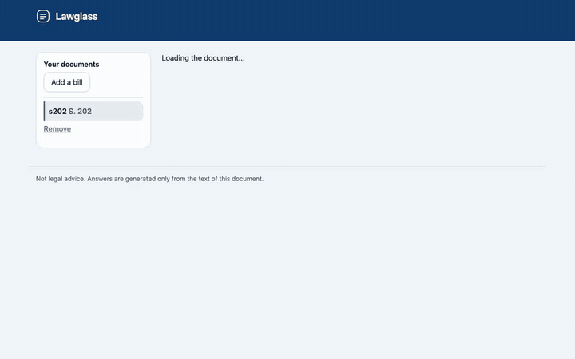
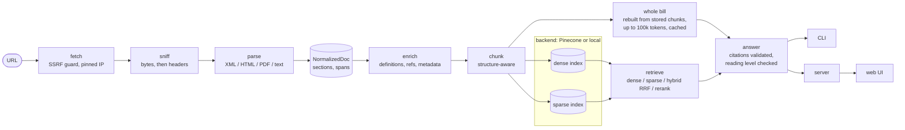

# Lawglass

[](https://github.com/ylove/lawglass/actions/workflows/ci.yml)

**Understand any bill in plain English.** Paste a link to legislation and get a plain-language explanation, with every point cited to the section and line it came from.

Lawglass is a free, open-source bill explainer. Bills are long, written for lawyers, and full of changes to other laws. Lawglass reads the whole text, then helps you answer the questions that matter: What does this bill do? Who does it affect? How might it affect me? Where did it come from? It runs on your own computer, and it answers only from the bill's own text.



_The demo shows a real federal bill, S. 202 of the 119th Congress, answered by Claude._

## What it does

- **A summary the moment you open a bill.** You never start with a blank page. You see the official title first, then a plain-language summary of what the bill does, with citations.
- **It reads the whole bill.** Most bills fit in one prompt, so Lawglass gives the model the entire text, not a handful of excerpts. Very large bills, such as a defense authorization act, use search over the text, plus the sections the matching passages refer to.
- **Section by section.** Each part of the bill gets one to three plain sentences with citations, and a "Show an example" button.
- **"What it could mean for one person."** Short illustrated stories show how a bill, or one section of it, might land on one made-up person. Numbers about that person, such as an income, are invented, and each one is labeled as an example. Every claim about what the bill does is cited to its text, and any rate or amount comes from the bill itself.
- **What the bill changes.** Many bills work by editing existing law. Lawglass tells struck-out (removed) text from newly added text, shows a before and after, and never reads removed words as current law.
- **Who it affects, and when.** Ask who is covered, what the penalties are, when it takes effect, how much money is involved, and what its terms mean.
- **"Who decides later?"** Many bills leave the details to an agency or official: "the Secretary shall prescribe regulations". Lawglass lists who decides what, what the bill depends on, and what has to happen before it takes effect. The list is read from the text itself, without a model. A one-line summary above it is written by the model and dropped whole if any sentence lacks a valid citation.
- **The laws it refers to, as official links.** Citations such as "15 U.S.C. 6809", a Public Law or an Ohio Revised Code section become links to the official source, with a note like "Federal law · mentioned in 3 sections". When the bill borrows a definition from the U.S. Code, Lawglass reads that definition, so answers can use it and cite it.
- **"How did it get here?"** For federal bills (from GovInfo) and Ohio bills (from the legislature's own API), see the stages, the committees and the versions, drawn from official records. A person or committee is named only when the record names them, never guessed. Strike-through in an introduced bill is the bill rewriting current law, and Lawglass does not call it an amendment by a legislator.
- **Sponsors, with links to their official pages** where the evidence supports the link. Otherwise you get clearly labeled search links.
- **“Find where it says that.”** Paste a sentence from a headline, press release or post. Get verified source words, a label showing whether they are added, removed or unchanged, plain context and a copyable receipt with the section, version and official link. Check wording in earlier official versions without a model call.
- **Questions in your own words.** Ask "Does this raise my taxes?" or "What does the bill cross out?" and get an answer with citations.
- **Plain language, measured.** Every answer shows its reading grade. When the summary reads above 8th grade, Lawglass asks again for simpler wording and keeps the new answer only if it still cites everything the first one did. Answers about struck or added text, declines and exact-wording answers are left as they are.
- **Federal, Ohio, New York and New Jersey bills.** Paste a bill's page on congress.gov, the Ohio legislature's site, the New York Senate or Assembly site, or the New Jersey legislature's site. New York and New Jersey mark removed words with brackets, and Lawglass reads them as removed. [Adding the other 47 states](docs/jurisdictions.md) is planned state by state.
- **A home for your documents.** The homepage takes a new link and lists the bills you have opened. On a shared server, each visitor sees only their own list.

## How to check an answer

Lawglass is built so you do not have to take its word for anything.

- **Every citation opens the exact text.** Click one to open the source passage next to the answer. For PDFs it shows the page and line. HTML and XML bills have no printed line numbers, so those citations point to the section, and the screen says so.
- **Struck and added text are marked in the text itself.** Removed text is struck through and added text is underlined, never shown by color alone. Struck text is left out of ordinary answers unless you ask about changes.
- **It answers only from the bill's text.** No news, no commentary, no outside sources. Each citation is checked against the passages the model was actually shown, and an answer that cites nothing is flagged. When the bill does not cover your question, Lawglass is meant to say so rather than guess.

## Quick start

Requires Node.js 22.13 or newer.

> Not on npm yet (publishing waits on [#7](https://github.com/ylove/lawglass/issues/7)). Until then, download the tarball attached to the [latest release](https://github.com/ylove/lawglass/releases/latest) (or build your own with `npm pack`) and replace `npx lawglass` below with `npx --package ./lawglass-<version>.tgz lawglass`.

```sh
npx lawglass init                       # save provider keys (file mode 0600)
npx lawglass <url>                      # ingest, then serve and open the document
npx lawglass <url> --no-open            # same, without opening the browser
npx lawglass ingest <url> --name hb62   # ingest only, with a label
npx lawglass ingest ./bill.pdf          # a local file works too (CLI only)
npx lawglass ask hb62 "When does this take effect?"
npx lawglass ask hb62 --chip what-changes
npx lawglass search hb62 "fees"          # cited passages as JSON, no model call
npx lawglass get-section hb62 sec-3     # one section, with struck and added words marked
npx lawglass list
npx lawglass remove hb62
npx lawglass cache clear               # delete cached downloads (documents and answers stay)
npx lawglass serve --port 4317          # local web UI; --public allows chips only; --no-open skips the browser
npx lawglass mcp                        # Model Context Protocol server on stdio, for AI agents (prototype)
```

**Install warnings.** npm may report deprecation notices for `whatwg-encoding` (through `cheerio` →
`encoding-sniffer`) and `node-domexception` (through `@google/genai` →
`google-auth-library` → `gaxios` → `node-fetch` → `fetch-blob`). These are harmless
notices from transitive dependencies and do not prevent installation or use. The current
Cheerio release and newer Google SDK still use these dependency chains; removing the
notices awaits compatible upstream updates.

Paste a bill's own page, for example:

- A federal bill on congress.gov: `https://www.congress.gov/bill/119th-congress/senate-bill/202`
- An Ohio bill: `https://www.legislature.ohio.gov/legislation/136/sb113`
- A New York bill: `https://www.nysenate.gov/legislation/bills/2025/S1234`
- A New Jersey bill: `https://www.njleg.state.nj.us/bill-search/2024/S1000`

If the link does not name a text version, Lawglass reads the latest one in the official record and tells you which version it read. You can also paste a PDF, XML, HTML or plain-text link, or a local file.

`init` asks for the key of an AI provider (Anthropic, OpenAI or Google, or any OpenAI-compatible endpoint). Your keys stay on your machine and go only to their own provider. Your question and the passages needed to answer it are what get sent to the provider. Provider details are in the engineers' section below. `<doc>` above is a label or a document-id prefix, and every flag is defined in [`src/cli/program.ts`](src/cli/program.ts).

`--chip <id>` is one of `summary`, `what-changes`, `history`, `who-affected`, `penalties`, `effective-date`, `money`, `definitions`, `sponsors`, `delegations`.

Coming from the earlier `legislation-summary` name? Move `~/.legislation-summary` to `~/.lawglass` to keep your saved keys and documents, and rename any `LEGSUM_*` environment variables to `LAWGLASS_*`.

## Not legal advice

Lawglass explains what a bill's text says. It is not a lawyer, and it does not tell you what a bill means for your situation. For a decision that matters, read the cited text and talk to a qualified attorney. Know its limits:

- **US first.** It was built and tested on U.S. federal, Ohio, New York and New Jersey bills. Other jurisdictions may work if you give it the bill's text, but their change marks may not be read, and you get no history view.
- **History covers federal and Ohio only,** and only what those official records contain.
- **Scans are read with care, not trusted.** A PDF needs a text layer: a scan with none stops with a clear message. A scan that was run through OCR is read, but each scanned page is flagged, because struck and added words cannot be detected on it.
- **Plain language is a goal, not a promise.** The target reading level is 7th grade. Before v1.1, measured grades averaged 8.5 to 10.2, mostly because legal terms push the score up ([results](docs/eval-analysis.md)). Since v1.1 every answer shows its grade. The summary is rewritten once from the bill when it reads above grade 8, and answers to your questions when they read above grade 10. A rewrite is kept only if it reads lower, cites every section the first answer did, and gains no citation or truncation warning. Declines, answers about struck or added text, and metadata answers are never rewritten.
- **It can be wrong.** In testing, every citation pointed at a passage the model was shown, but a citation shows where an answer came from, not that the answer is right. Check the cited text.
- **Scenarios are illustrations.** The people in them are made up, and the dollar figures about them are examples.

> **Status: v1.1.** Everything described here is on `main` and tested.

<details>
<summary>For engineers and recruiters: how it works, retrieval quality, cost and security</summary>

Lawglass is a production-style document pipeline: structure-aware parsing, whole-bill prompts with caching when the bill fits and hybrid retrieval (dense, sparse, rerank) when it does not, validated citations, and a measured eval. This section holds the architecture, when the whole bill goes into the prompt and when it does not, the eval results (including the misses), security notes, and development setup.

### Architecture



Everything below `NormalizedDoc` is format-agnostic. The CLI, server and eval all call the same functions in [`src/core/pipeline/`](src/core/pipeline/).

- **Fetch** ([`src/core/fetch/`](src/core/fetch/)). `http`/`https` only, ports 80, 443, 8080 and 8443, 30 s timeout, 50 MB cap, at most 5 redirects. Every hop is re-validated and connected by pinned IP. Format is sniffed from the bytes first (`%PDF`, XML prolog or root, `<html`), then Content-Type, then extension. Raw bytes are cached by SHA-256.
- **Parse** ([`src/core/parse/`](src/core/parse/)). XML (`saxes`), HTML (`cheerio`), PDF (`pdfjs-dist`) and plain text all produce a `NormalizedDoc`: a section tree whose text is a list of `unchanged | inserted | deleted` spans. PDF also recovers printed line numbers and strips running headers. New York and New Jersey bills mark deletions with brackets; a bracket counts as a deletion only once the bill's own legend (New York: "matter in brackets [ ] is old law to be omitted") is found ([`change-marks.ts`](src/core/parse/change-marks.ts)). A PDF with no text layer stops with a clear error; an OCR'd scan is read, and each scanned page is flagged because its strike and underline marks cannot be seen.
- **Enrich** ([`src/core/enrich/`](src/core/enrich/)). Definitions (each becomes its own chunk), internal cross-references, external references, and bill metadata. External references get official links built by rule (GovInfo U.S. Code, Public Law and Statutes at Large, eCFR, Ohio Revised Code, and the New York consolidated laws Lawglass can map), never by search. When a definition points at the U.S. Code, ingest reads that section from GovInfo (exact host, capped, at most 8 per bill) and keeps it as citable reference text (`[S:ref:usc/15/6809]`). Metadata comes from structured fields when present. Otherwise an LLM extracts it under a strict zod schema where every field is nullable and guards reject values not found in the text.
- **Chunk** ([`src/core/chunk/`](src/core/chunk/)). Never crosses a section boundary. Targets 300 to 450 tokens, hard maximum 480, with 50 tokens of overlap. Each chunk is embedded with its breadcrumb prefix (`Sec. 4 > (b) Eligibility: ...`); the raw text is stored separately for display. Chunk ids are deterministic, so re-ingest is an idempotent upsert.
- **Index** ([`src/core/index/`](src/core/index/)). One dense and one sparse index per document, with a `RetrievalBackend` port ([`src/core/model/`](src/core/model/), frozen by [decision 0005](docs/decisions/0005-frozen-contracts.md)) in front of Pinecone and the local store.
- **Retrieve** ([`src/core/retrieve/`](src/core/retrieve/)). Used for bills too large to send whole. Four modes: `dense`, `sparse`, `hybrid` (40 candidates from each index, merged by Reciprocal Rank Fusion with k=60) and `hybrid_rerank` (the default: fuse, rerank at most 64 candidates, keep 8). Then up to 5 definitions of terms used in the hits are injected, and up to 3 sections the hits themselves refer to ("as described in section 4") are added as context.
- **Answer** ([`src/core/answer/`](src/core/answer/)). A bill up to 100,000 tokens goes to the model whole, as escaped `<part>` data inside a cached prefix (system prompt plus bill), with the question last, so follow-up questions reuse the cache ([decision 0015](docs/decisions/0015-whole-bill-context.md)). Larger bills send the retrieved excerpts instead. The system prompt demands citations, a verbatim decline sentence when the bill does not answer, and about a 7th-grade reading level. Citations are validated after generation (see [Security](#security-notes)). Sentences about "the excerpts" or "the provided text" are removed. An answer above the grade ceiling gets one more call with a stricter instruction; the new answer replaces the first only if it reads lower, cites every section the first cited, and gains no citation or truncation warning. Declines, truncated answers, metadata chips and answers about changes are never regenerated ([spec amendment 25](docs/spec.md)).
- **Chips** ([`src/core/chips.ts`](src/core/chips.ts)). Ten one-click questions, each with an explicit strategy: sparse-heavy (`effective-date`, `penalties`), filtered by chunk type (`money`, `definitions`), reranked (`who-affected`), outline map-reduce (`summary`), exact amendment spans (`what-changes`), official records (`history`), metadata only (`sponsors`), and a deterministic extractor with an optional cited lede (`delegations`). In whole-bill mode the retrieval chips read the whole bill.
- **Section by section** ([`src/core/breakdown/`](src/core/breakdown/)). Structured calls, in batches, write one to three cited sentences for each substantive part (boilerplate such as the short title and severability is skipped). The run starts in the background after the summary and is cached. Each part can draw its own example; a whole-bill-mode bill with at most 8 such parts draws them in advance, one at a time.
- **Surfaces.** CLI in [`src/cli/`](src/cli/), server in [`src/server/`](src/server/), React UI in [`src/web/`](src/web/).

### Whole bill or retrieval

Since v1.1, a bill that fits in 100,000 tokens is sent whole. Many bills do: S. 1582 (the GENIUS Act) is about 33,000 tokens and S. 5687 about 5,500. The model then sees every definition and cross-reference, and never writes about what "the excerpts" leave out. With Anthropic models the bill sits in a cached prompt prefix, so later questions on the same bill read it at about a tenth of the normal input price. The first call pays a little more to write the cache, and an idle cache expires, so the saving is for questions asked close together ([decision 0015](docs/decisions/0015-whole-bill-context.md)). Bills above the limit use retrieval, for the reasons measured below.

Measured on the largest fixture, the FY2025 NDAA (8,618 sections), against Claude Sonnet 5.5's 1M-token window ([full write-up](docs/eval-analysis.md#retrieval-or-the-whole-bill-in-the-prompt)):

|                                            | Retrieval (`hybrid_rerank`) | Whole bill in the prompt                                                                                                              |
| ------------------------------------------ | --------------------------- | ------------------------------------------------------------------------------------------------------------------------------------- |
| Input tokens per question                  | about 4,500                 | about 936,000 (compact form; the structured form is 2.2M and does not fit)                                                            |
| Cost per question at list price (computed) | about $0.01                 | $1.87 uncached; about $0.09 to $0.19 with the bill cached; $3.74 as measured through Claude Code, which wrote a fresh cache each call |
| Correct on 5 pre-chosen questions          | 4                           | 5                                                                                                                                     |
| Answer time after the first call           | 4 to 9 s                    | 3 to 5 s (35 s for the first)                                                                                                         |

On this small sample the whole bill was at least as accurate: retrieval missed _"What is the full short title of this Act?"_ because the NDAA has dozens of "may be cited as" sections. Retrieval's case is cost (about 200 times fewer tokens), bills that do not fit at all (the NDAA compact form already fills 94% of the window), and what a pipeline can do that a flat prompt cannot: keep struck text out unless the question is about changes, add the definitions a passage depends on, cite page and line, and pick a strategy per question.

### Amendment markup

Bills that amend existing law show the change with typography: struck-through text is being repealed and underlined text is being added. In a PDF's text layer, or in flattened HTML, repealed words are character-for-character ordinary words. A naive RAG pipeline embeds them as current law, retrieves them, and answers "the bill requires X" when the bill deletes X. For a legislation tool that is the failure that matters most.

How it is handled:

- **Detect.** Every parser maps markup to a span status.
  - **HTML** ([`html.ts`](src/core/parse/html.ts)): `<s>`, `<strike>` and `<del>` mean deleted; `<u>` and `<ins>` mean inserted; inline `text-decoration` and `.class` or `tag.class` CSS rules are honored. A strike wins over an underline. Tag-only rules are ignored on purpose, so ordinary link underlines are not read as insertions.
  - **PDF** ([`pdf-geometry.ts`](src/core/parse/pdf-geometry.ts)): there is no markup, only thin horizontal rules drawn near glyphs. Marks are classified in ems from the baseline, per glyph, requiring 70% coverage, with negative controls for table rules, highlights, link underlines and white cover-up rectangles. Struck and underlined together is read as deleted, because calling repealed text current is the worse error. [Decision 0006](docs/decisions/0006-pdf-amendment-geometry.md) records the measurements and every threshold.
- **Separate.** Deleted spans never go into normal chunk text. They become their own chunks with `amendmentStatus = deleted`. Inserted text stays in normal chunks and is flagged.
- **Exclude by default.** Retrieval filters to `unchanged` and `inserted` unless the question is about changes (a pattern check on the question) or the chip explicitly asks for deleted text. After the backend returns, retrieve filters again, so a backend that ignores the filter cannot leak struck text. The answer prompt separately tells the model to say "the bill removes ..." for deleted excerpts.
- **Keep struck words out of structure.** On PDFs, sections are detected on the text with struck characters removed, so a struck heading or a struck relettered marker never becomes a `heading`, breadcrumb or embedding text. A local test checks this on the real HB 62 file.
- **`what-changes` shows before and after.** It is built from the section tree, not from retrieval ([`chip-changes.ts`](src/core/chip-changes.ts)). For each changed section the model sees two excerpts of only the sentences that contain a change: the BEFORE sentence with struck words as `[-...-]`, and the AFTER sentence with new words as `[+...+]`. Struck words appear only in the BEFORE excerpt. The chip shows at most 25 changed sections and counts the rest.

The real Ohio HB 62 fixture (135th General Assembly, as introduced) parses to 26 struck runs and 28 inserted runs, matching a count taken by hand on the rendered pages. Fixtures are downloaded locally, never committed (see [Development](#development)).

### Retrieval quality

Retrieval quality is measured, not asserted. Five golden sets are frozen in [`src/eval/golden/`](src/eval/golden/), 21 to 28 questions each, for Ohio SB 113, SB 203 and HB 62, federal S. 202 and federal H.R. 5009 (the FY2025 NDAA, about 1.8 million characters). Each question names its expected `section_id`s and has a kind: exact citation lookup, paraphrase, definition-dependent, "what does it remove" (struck text), or unanswerable (three per set, which should be declined). The sets were frozen at commit `7639f18` before the first run and have not been edited since.

Local backend (`bge-small-en-v1.5` embeddings, BM25, `ms-marco-MiniLM-L-6-v2` reranker), recall@5 / MRR, from [`eval/results.md`](eval/results.md); `hybrid_rerank` is the default:

| Fixture                  | dense       | sparse      | hybrid (RRF) | hybrid (weighted) | hybrid_rerank (default) |
| ------------------------ | ----------- | ----------- | ------------ | ----------------- | ----------------------- |
| Ohio HB 62               | 0.95 / 0.79 | 0.90 / 0.72 | 1.00 / 0.85  | 0.95 / 0.80       | 0.95 / 0.87             |
| Ohio SB 113              | 1.00 / 0.81 | 0.83 / 0.76 | 0.89 / 0.84  | 0.94 / 0.84       | 1.00 / 0.90             |
| Ohio SB 203              | 0.71 / 0.63 | 0.76 / 0.63 | 0.86 / 0.66  | 0.86 / 0.66       | 0.95 / 0.74             |
| Federal S. 202           | 0.90 / 0.70 | 0.68 / 0.62 | 0.80 / 0.71  | 0.85 / 0.71       | 0.85 / 0.83             |
| Federal H.R. 5009 (NDAA) | 0.96 / 0.89 | 0.82 / 0.68 | 0.92 / 0.81  | 0.96 / 0.92       | 0.88 / 0.86             |

Pinecone backend (`llama-text-embed-v2`, `pinecone-sparse-english-v0`, `bge-reranker-v2-m3`), `hybrid_rerank` only, recall@5 / MRR, from [`eval/results-pinecone.md`](eval/results-pinecone.md) (Starter tier, commit `3a0851a`, 2026-10-14), next to the local numbers above. The two backends differ in embedder, sparse model and reranker, and the runs came from different commits (local `a651f35`, Pinecone `3a0851a`), so the comparison is indicative, not controlled:

| Fixture                  | local hybrid_rerank | Pinecone hybrid_rerank |
| ------------------------ | ------------------- | ---------------------- |
| Ohio HB 62               | 0.95 / 0.87         | 1.00 / 0.98            |
| Ohio SB 113              | 1.00 / 0.90         | 0.94 / 0.95            |
| Ohio SB 203              | 0.95 / 0.74         | 0.88 / 0.91            |
| Federal S. 202           | 0.85 / 0.83         | 0.90 / 0.90            |
| Federal H.R. 5009 (NDAA) | 0.88 / 0.86         | 0.96 / 0.94            |
| Average                  | 0.93 / 0.84         | 0.94 / 0.94            |

Pinecone ranks better on all five bills (higher MRR). It is not uniformly better at recall@5: it is lower on SB 113 (17 of 18 expected sections in the top 5, against 18) and SB 203 (37 of 42, against 40). One question moves recall@5 by about 0.05, so treat the recall differences as small. The other modes' Pinecone rows are in the results file.

What this shows, plainly:

- **The default mode ranks best on four of five bills** (highest MRR), and finds more of the right sections than dense alone on SB 203. It ties dense on two bills and **loses to dense on two**: S. 202 by one question (17 of 20 in the top 5, against 18) and the NDAA by two (22 of 25, against 24).
- **Where each mode wins** (share of questions with a relevant section in the top 5, all bills pooled): `hybrid_rerank` leads on exact lookups (0.97 vs 0.90 for dense) and definitions (0.84 vs 0.79); dense leads on paraphrases (0.95 vs 0.93) and on "what does it remove" (1.00 vs 0.91).
- **Dense misses, the reranked hybrid finds it.** SB 203, _"Does trading one gun for another count as a 'transfer'?"_ Dense retrieval ranks the definitions division that answers it 8th, behind seven other passages of the same section (2923.27), and BM25 alone does not put it in its top 10. Plain fusion does not fix it either. Because both lists feed one candidate pool, the cross-encoder gets to read the question against that division directly and ranks it first: the win is the reranker's.
- **Where the reranker hurts.** On the NDAA, _"Does the military now have to buy American-made forks, spoons, and dishes?"_ Dense ranks Sec. 842, "Domestic production of stainless steel flatware and dinnerware", first; after reranking it is not in the top 10. Our reading, not yet tested: the small cross-encoder (22M parameters, trained on web search) does not connect _forks and spoons_ to _flatware_, and the NDAA's very long heading paths (Division > Title > Subtitle > Sec.) may crowd its 512-token window. We then tried the stronger reranker, `bge-reranker-v2-m3` on Pinecone, and **it did not fix this miss**: Sec. 842 is still not in the top 10 (it puts Sec. 844 and Sec. 845 first), even though Pinecone's dense search ranks 842 first and its RRF hybrid fourth. So a stronger reranker is not the answer for this question; the heading-path hypothesis is still untested. Weighted fusion without rerank is the best local mode on the NDAA.
- **Two fixes came from this eval**, both reported with before and after numbers in the [analysis](docs/eval-analysis.md). The reranker originally scored chunk text without its heading path, while the embedder saw both; giving it the same context (#97) raised MRR on four of five bills (average 0.797 to 0.841) while average recall@5 stayed flat (0.924 to 0.926), because S. 202 lost two borderline questions. And questions in everyday words ("what does the bill _cross out_", "does it _get rid of_ the rule") were not recognised as questions about changes, so the struck text never reached the model (#101).

**Answers** (all 119 questions, Claude Sonnet 5.5, [`eval/results-answers.md`](eval/results-answers.md)): every citation pointed at a section the model was shown, on all five bills. 13 of 15 unanswerable questions got the exact decline sentence; the other two said the bill does not cover the question and then described what it does cover. On HB 62, the only bill with struck text, no answer stated repealed text as current law (the final run's leakage check flagged one answer; answers are not stored, so the questions were asked again and every flagged answer was read: all were false positives). Mean reading grade is 8.5 to 10.2, above the grade-7 target. The full analysis, including what changed because of it, is in [docs/eval-analysis.md](docs/eval-analysis.md). Pinecone `hybrid_rerank` rows are in the table above; the full Pinecone table is in [`eval/results-pinecone.md`](eval/results-pinecone.md). Each table records the commit, models and golden-set freeze it came from. Per-question ranks for every mode are written to `eval/runs/*.json`, and `eval compare` lists the questions where two modes disagree ([details](docs/eval.md)).

Caveats: 21 to 28 questions per bill means one question moves recall@5 by about 0.05. Ranks are chunk ranks (the first chunk whose section, or an ancestor or descendant, is expected). Two questions name their section numbers outright (hb62-03, sb203-08), and some paraphrases reuse rare words from the text, which makes them easier for BM25.

### Security notes

- **SSRF guard** ([`src/core/fetch/`](src/core/fetch/)).
  - IPv4 addresses are checked against private, loopback, link-local, CGNAT, multicast, documentation and other special-use ranges. Cloud metadata `169.254.169.254` falls inside link-local. IPv6 is an allowlist: only global unicast (`2000::/3`) is fetched, minus the IANA special-purpose ranges inside it (Teredo and the rest of `2001::/23`, documentation `2001:db8::/32` and `3fff::/20`, and so on).
  - IPv6 forms that embed an IPv4 address (IPv4-mapped, NAT64, 6to4, Teredo) are unwrapped and checked. Scoped and unparsable addresses fail closed.
  - The connection goes to the validated address itself, pinned, so a DNS answer cannot change between check and connect (rebinding).
  - Each redirect is re-resolved and re-validated, up to 5. An `https` address that redirects to `http` is refused; plain `http` is followed only when you typed an `http` address. Credentials in URLs are refused, as are ports outside 80, 443, 8080 and 8443.
  - Bodies are capped at 50 MB, with a 30 s timeout.
  - Downloaded bytes are cached under `~/.lawglass/cache` only after they parse, removed with their document, and trimmed to 500 MB (least recently used first; set `LAWGLASS_CACHE_MAX_MB` to change). `lawglass cache clear` deletes them all.
- **Prompt injection** ([`src/core/answer/`](src/core/answer/)). Bill text is hostile data. Bill text (whole or excerpts), reference text read from the U.S. Code and the user's question are XML-escaped and citation markers in them are neutralized, so none of them can close a tag or forge a source. The system prompt states that this text is data, not instructions. Citations are validated: every `[S:id]` must be a section that was in the prompt; invalid markers are stripped and reported, and an answer with no valid citation (other than the exact decline sentence) carries a warning. Synthetic injection samples live in [`tests/synth/injection.ts`](tests/synth/injection.ts). Citation validation is held to 90% line coverage along with the fetch layer.
- **Local server** (`serve`). Binds to `127.0.0.1` by default. In local mode, a request whose `Host` is not a loopback name is refused, which blocks DNS-rebinding attacks from web pages you visit; in every mode, an API request whose `Origin` does not match its `Host` is refused. Cancelling a question or an ingest in the UI aborts the work, including the download.
- **Budgets** ([`src/core/pipeline/`](src/core/pipeline/), [decision 0012](docs/decisions/0012-security-posture.md)). At most 2 ingests and 4 answers run at once, model-backed calls have a per-minute ceiling, and a question is at most 500 characters. These live in core, so the CLI, the server and the MCP server are all covered. Background work (section briefs, pre-drawn examples) yields to a person waiting.
- **Public mode** (`serve --public`). Chips only (no free-form questions), per-IP limits of 20 questions and 3 ingests per hour, a 200-page ingest cap, and a global document cap that refuses new documents instead of evicting a listed one. The Cloudflare Turnstile check is still a stub, so public mode is not ready for an open deployment until [#180](https://github.com/ylove/lawglass/issues/180) lands.
- **Hosted private preview** ([`deploy/cloud-run/`](deploy/cloud-run/README.md)). One Cloud Run instance runs `serve --private` for people with an invite link. Keys live in Secret Manager and reach the container only at runtime, never the image, the repository or CI. The image runs as a non-root user, and its service account can read two secrets and write one private bucket. State is saved to that bucket as a tarball. See [decision 0014](docs/decisions/0014-hosted-private-preview.md) and the [threat model](docs/security/threat-model.md).
- **MCP server** (`lawglass mcp`, a prototype). Stdio only, local backend, no model calls and no keys. Document text comes back inside a per-response wrapper labelled as untrusted data, struck and inserted words carry markers with a per-response id, and citation fields are checked against strict shapes so document words cannot leak outside the wrapper. When change marks could not be read (an unread scan, or a missing bracket legend) the text is reported as `unknown`, never as current law. See [decision 0013](docs/decisions/0013-agent-access.md).
- **Bring your own keys.** `init` writes the config file with mode 0600. A config file that other users can read is refused: commands skip it with a warning, and `init` stops unless `--force` replaces it. Keys are read from the environment first, then that file, then a masked prompt on a TTY. Keys go only to their own provider, are not inferred from another provider's variables, and are never logged or put in error messages; SDK diagnostic logging is off: before the Pinecone SDK is constructed, `PINECONE_DEBUG` (request and response bodies) and `PINECONE_DEBUG_CURL` (the `Api-Key` header) are cleared from the process environment, in both the CLI runtime and the adapter. `.env` and fixtures are ignored by git, and CI runs Gitleaks over the full history.
- **`claude-cli` sandboxing.** Each call runs in a fresh temporary directory holding only the system prompt file, with built-in tools disabled (`--tools ""`), all MCP servers disabled, one turn, slash commands, hooks and settings sources off, no session persistence, and no permission-bypass flag. The child sees only basic process variables plus `CLAUDE_*` and `ANTHROPIC_*`, so other providers' keys and app settings are excluded. `ANTHROPIC_API_KEY` and `ANTHROPIC_AUTH_TOKEN` are withheld too, so the CLI bills your Claude login, unless you set `LAWGLASS_CLAUDE_CLI_USE_API_KEY=1`. The model name must match `^[A-Za-z0-9][A-Za-z0-9._:-]{0,99}$`, so it cannot be read as a flag. It refuses to run for real in CI.

Session cookie names include the server port so local instances do not overwrite each other’s
sessions. Cookies are scoped by host, not port: other services on the same host (including
`127.0.0.1`) can receive them. The name separates instances; it does not isolate the cookie.
A hosted private preview (`serve --private`) runs one instance per host and keeps the plain name.
Behind a proxy, the name uses the server’s listening port (for example, `8080`).

### Hosting a private preview

Invite holders get the full app, including free-form questions, scenarios and live summaries.
Run one instance behind HTTPS (for example, Cloud Run's TLS endpoint):

```sh
node dist/cli.js serve --private --host 0.0.0.0 --port 8080 --no-open --trust-proxy 1
```

Set `LAWGLASS_ACCESS_KEY` to a random secret of at least 32 characters and keep it in your
hosting platform's secret manager. Set `LAWGLASS_PUBLIC_ORIGIN` to your HTTPS origin, then
send invited people `https://your-host.example/?k=<access key>`. The link creates a secure
30-day browser session. Rotating the key revokes existing sessions. People without an invite
see a preview page.

Use the local backend and a configured Anthropic, OpenAI or Google provider; hosted modes
refuse `claude-cli` and the test-only `mock` provider. `--private` and `--public` are mutually
exclusive. `--trust-proxy` defaults to `0`; set it to the number of proxies you trust, counted
from the right of `X-Forwarded-For`.

Both hosted modes read federal, Ohio, New York and New Jersey bill hosts by default.
`LAWGLASS_INGEST_HOSTS` can replace that list with comma-separated exact hostnames. Each hosted
ingest has a 15-minute processing deadline.

Each visitor gets a random reader cookie, and "Your documents" shows only the bills that visitor
added or opened. The documents themselves are shared, so a bill is ingested once for everyone,
and documents nobody lists are evicted first ([decision 0016](docs/decisions/0016-per-reader-library.md)).
`LAWGLASS_EXAMPLES` sets the example links on the homepage.

### Providers, keys and backends

`init` writes `~/.lawglass/config.json`. Environment variables win over the file. `init --non-interactive` copies the provider settings and keys currently in your environment into that file (mode 0600) without prompting, which is meant for scripted setups; it prints no keys. Without a configured provider, `ask` and `ingest` fail with a message listing the options. List, remove and the `sponsors` chip work without any key.

| Provider     | Key                 | Notes                                                                                      |
| ------------ | ------------------- | ------------------------------------------------------------------------------------------ |
| `anthropic`  | `ANTHROPIC_API_KEY` | Defaults `claude-sonnet-5-5` (answers) and `claude-haiku-5-5` (metadata extraction)        |
| `openai`     | `OPENAI_API_KEY`    | `OPENAI_BASE_URL` points it at any OpenAI-compatible endpoint (OpenRouter, Ollama, Groq)   |
| `google`     | `GOOGLE_API_KEY`    | Official Google GenAI SDK                                                                  |
| `claude-cli` | none                | Opt-in, local development only: `LAWGLASS_LLM_PROVIDER=claude-cli`. Uses your own `claude` |
| `mock`       | none                | Deterministic, used by tests and CI                                                        |

Provider keys are sent only over `https:` or to `localhost`, `127.0.0.1` or `[::1]`. An Ollama or LM Studio server on a LAN over plain `http:` gets no key, which is fine because it needs none; set `LAWGLASS_ALLOW_INSECURE_KEY=1` to send one anyway. The `claude-cli` provider never reads your stored keys, forwards no API credentials unless you opt in (see above), and is never chosen automatically ([decision 0003](docs/decisions/0003-claude-cli-provider.md), [provider details](docs/llm-providers.md)). Override models with `LAWGLASS_ANSWER_MODEL` and `LAWGLASS_EXTRACT_MODEL`.

Ingest limits are set through environment variables, outside `config.json`:

| Variable                    | Local default | Public default |
| --------------------------- | ------------- | -------------- |
| `LAWGLASS_MAX_PAGES`        | 5,000         | Fixed at 200   |
| `LAWGLASS_PARSE_TIMEOUT_MS` | 120,000 ms    | 30,000 ms      |
| `LAWGLASS_MAX_CHUNKS`       | 20,000        | 3,000          |

Values must be positive integers. HTML is limited to 15 MiB locally and 5 MiB publicly, with a conservative nesting ceiling of 512 levels checked before DOM construction. Other non-PDF formats keep the 50 MiB local byte cap and use 10 MiB publicly; PDF downloads keep the 50 MiB byte cap. PDF page limits are checked before page extraction. Parse deadlines and cancellation are cooperative for synchronous HTML/XML work, with checks between input chunks or DOM nodes; PDF waits can also be cancelled. The chunk ceiling includes definition records added during enrichment.

#### Backends

- **local** (default): no Docker, no account. Dense vectors from quantized `bge-small-en-v1.5` (384 dimensions) via transformers.js, sparse search with an explicit BM25 (`k1=1.2`, `b=0.75`), and a quantized MiniLM cross-encoder as reranker. About 59 MB of models download once, from revisions pinned in [`models.lock.json`](models.lock.json). Code: [`src/core/index/local/`](src/core/index/local/).
- **pinecone**: selected when `PINECONE_API_KEY` resolves; integrated-inference dense and sparse indexes plus hosted rerank ([decision 0001](docs/decisions/0001-pinecone-plus-local-backend.md)). Each document is a namespace. A document counts as indexed only after a completion marker is written once every batch has landed in both indexes, so a half-finished ingest is never mistaken for a finished one. Code: [`src/core/index/pinecone/`](src/core/index/pinecone/). Its live contract suite runs nightly when a key is configured. It passed 21 of 21 on 2026-10-14; a later run hit one eventual-consistency flake, a search issued right after a delete that still returned the deleted record ([#163](https://github.com/ylove/lawglass/issues/163)).

Embeddings never go through the LLM provider.

Pinecone ingest handles rate limits for you. It retries 429 responses with jittered exponential backoff, honors `Retry-After`, splits an over-large batch in half down to one record, and counts a document as indexed only after a completion marker is written. Only 429 is retried; 5xx and 402 (quota) errors fail immediately. Budgets and pacing are tunable with the `LAWGLASS_PINECONE_*` environment variables (`UPSERT_RETRY_BUDGET_MS`, `QUERY_RETRY_BUDGET_MS`, `UPSERT_BATCH_DELAY_MS`, `UPSERT_MAX_BATCH_TOKENS`); defaults are in [`src/core/index/pinecone/`](src/core/index/pinecone/).

### Status

| Piece                                                                                            | State on `main`                                                                                                                                                                          |
| ------------------------------------------------------------------------------------------------ | ---------------------------------------------------------------------------------------------------------------------------------------------------------------------------------------- |
| Fetch, parse, enrich, chunk, local backend, retrieval, answer, chips                             | Implemented and tested                                                                                                                                                                   |
| CLI `init`, `ingest`, `ask`, `search`, `get-section`, `list`, `remove`, `serve`, `eval`, `<url>` | Implemented and tested; e2e and package smoke run in CI                                                                                                                                  |
| Server: REST, SSE, public mode, web UI                                                           | Implemented and tested                                                                                                                                                                   |
| Eval harness and golden sets                                                                     | Implemented; results in [`eval/results.md`](eval/results.md)                                                                                                                             |
| Pinecone adapter and CLI runtime                                                                 | Wired into all commands; live contract suite and five-bill eval run on Starter (2026-10-14)                                                                                              |
| Hosted private preview (Cloud Run)                                                               | Deployment files and runbook in [`deploy/cloud-run/`](deploy/cloud-run/README.md)                                                                                                        |
| Jurisdictions                                                                                    | Federal, Ohio, New York and New Jersey; the plan for the other states is in [`docs/jurisdictions.md`](docs/jurisdictions.md) ([decision 0017](docs/decisions/0017-jurisdictions.md))     |
| MCP server (`lawglass mcp`)                                                                      | A prototype and measurement harness. No claim that it beats pasting a bill into a chat until its pre-registered evaluation passes ([decision 0013](docs/decisions/0013-agent-access.md)) |

### Development

```sh
npm ci
npm run check            # lint, typecheck, format check, tests with coverage
npm run build            # dist/cli.js, dist/server.js, dist/web/
node dist/cli.js --help
```

- `npm run fixtures:fetch` downloads the public documents listed in [`fixtures/manifest.json`](fixtures/manifest.json) into the gitignored `fixtures/downloads/`, checking SHA-256 and size. Fixtures are never committed; local fixture tests skip when the files are absent, and CI uses generated samples from [`tests/synth/`](tests/synth/). See [`fixtures/README.md`](fixtures/README.md).
- Pinecone Starter includes 500 BGE rerank requests per month. `eval --backend pinecone` estimates the rerank calls before starting and warns above 100; the default run reranks answerable questions in `hybrid_rerank`, and `--answers` adds a rerank call for every question in that mode. Narrow the run with `--fixture` or choose `--mode dense`, `sparse` or `hybrid` to avoid rerank calls.
- `node dist/cli.js eval --backend local` reruns the eval on the downloaded fixtures and writes `eval/results.md` (add `--answers` to score answers with your configured provider; it makes one model call per question and mode).
- `npm run models:fetch` pre-downloads the local models. `npm run test:models` runs the offline suite against the real models (not part of `check`, which uses fakes).
- `npm run test:live` runs key-gated provider contract tests and spends tokens. It never runs the Claude CLI.
- `npx tsx scripts/record-demo.ts --doc <label>` re-records the demo GIF from a running `serve` (needs Chromium from Playwright and ffmpeg).
- `npm run smoke:package` and `npm run test:e2e` run the packed-tarball smoke and the Playwright suite locally. Set `PLAYWRIGHT_BROWSERS_PATH="$PWD/.cache/ms-playwright"` and run `npx playwright install chromium` once.
- Unit tests block outbound HTTP, so adapters take injected fetchers and spawners.

CI ([`ci.yml`](.github/workflows/ci.yml)) runs these jobs:

| Job                  | What it checks                                                                                                      |
| -------------------- | ------------------------------------------------------------------------------------------------------------------- |
| `lint-type`          | ESLint, both typechecks, Prettier, `npm audit` for production deps                                                  |
| `audit-full`         | `npm audit` over the full tree, since pdfjs-dist is a dev dependency bundled into the CLI                           |
| `lockfile-integrity` | Registry-only sources with integrity hashes, and `npm audit signatures`                                             |
| `zizmor`             | Static analysis of the workflows themselves (injection, permissions, unpinned actions)                              |
| `test`               | Coverage-gated tests on Node 22 and 24 (Ubuntu) and Node 22 (macOS)                                                 |
| `build`              | Production build and a `--help` smoke check                                                                         |
| `no-fixtures-guard`  | Fails if real legislation files are committed                                                                       |
| `secrets`            | Gitleaks over full history                                                                                          |
| `dependency-review`  | Blocks high-severity vulnerabilities and GPL-3.0/AGPL-3.0 licences on pull requests                                 |
| `eval-smoke`         | Synthetic golden set end to end (fails if `hybrid_rerank` < `dense`), then the prompt-injection eval                |
| `package-smoke`      | Packs the tarball (allowlisted contents), installs it in a clean dir, runs `init`, `ingest`, `ask`, `list`, `serve` |
| `e2e`                | Chromium against the packed build: chip streaming, citation drawer, SSRF block, remove                              |

CodeQL, OSV-Scanner, OpenSSF Scorecard, a nightly Pinecone contract check (only with a key) and a local-model offline suite run in their own workflows. Pushing a `v*` tag runs the release workflow, which attaches the tarball, checksums and an SBOM to the GitHub release.

Conventions are in [`AGENTS.md`](AGENTS.md): the frozen contracts in `src/core/model/`, the product name only in `brand.ts`, tests beside code, and no network in unit tests. The [spec](docs/spec.md) is the source of truth and its Amendments override the rest. Design choices and their reasons are recorded in [`docs/decisions/`](docs/decisions/).

</details>

## Roadmap

- **v1.5:** resolve a bill from number plus jurisdiction to a URL, then run the same pipeline.
- **v2:** natural-language discovery search across bills.
- **v2:** official secondary sources only (fiscal notes, nonpartisan analyses). News articles are never used.
- Read more of the law a bill refers to. Today only U.S. Code definitions the bill borrows are read; everything else is an official link.
- Akoma Ntoso export of the normalized document.
- **Known gaps from the eval:** the forks/flatware miss on large bills; a sturdier signal for "is this question about what changed" ([#104](https://github.com/ylove/lawglass/issues/104)); before-and-after excerpts for one-word strikes in free-form questions ([#102](https://github.com/ylove/lawglass/issues/102)); consistent declines ([#109](https://github.com/ylove/lawglass/issues/109)); answers closer to a 7th-grade reading level, including the section-by-section briefs ([#320](https://github.com/ylove/lawglass/issues/320)).
- **More states**, family by family: the 20 states that mark changes with strike-through and underline, like Ohio, come first ([plan](docs/jurisdictions.md)).
- **Agent access:** run the pre-registered MCP evaluation (Lawglass tools against the same bills pasted into a model with citations and caching) before making any claim about it.
- An open public site. The hosted preview stays invite-only until public mode has had its own review ([#180](https://github.com/ylove/lawglass/issues/180)).

## License

[MIT](LICENSE)
